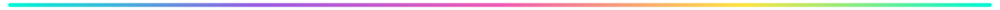
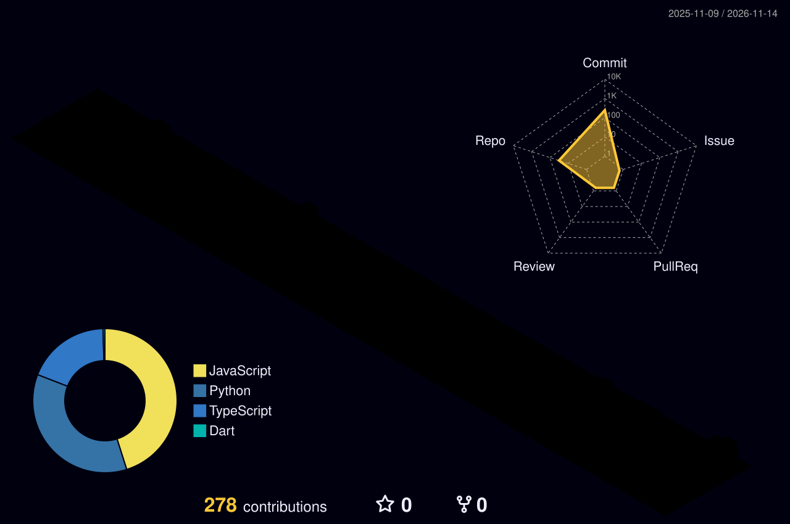

<!-- ================= HEADER ================= -->
<p align="center">
  
</p>

<p align="center">
  <a href="https://git.io/typing-svg">
    
  </a>
</p>

<p align="center">
  <a href="https://linkedin.com/in/YOUR_LINKEDIN"></a>
  <a href="https://twitter.com/YOUR_TWITTER"></a>
  <a href="https://instagram.com/YOUR_INSTAGRAM"></a>
  <a href="https://YOUR_PORTFOLIO"></a>
</p>



<!-- ================= ABOUT ================= -->
##  About Me

<table>
<tr>
<td width="55%">

```ts
const noufal = {
  role:        "Full-Stack Developer",
  location:    "India 🇮🇳",
  building:    ["Swiggy-style food delivery app 🍔", "cool side projects"],
  learning:    ["System Design", "Cloud & DevOps", "AI/ML"],
  stack:       { frontend: ["React", "Next.js", "Tailwind"],
                 backend:  ["Node.js", "Express", "MongoDB"] },
  funFact:     "I debug faster after biryani 🍛",
  openTo:      "collabs, freelance & cool ideas ✨",
};
```

</td>
<td width="45%" align="center">
  
</td>
</tr>
</table>


<!-- ================= TECH STACK ================= -->
## ⚡ Tech Arsenal

<p align="center">
  
  <br/><br/>
  
  <br/><br/>
  
</p>


<!-- ================= STATS (custom-built, live data) ================= -->
## ⚛️ Contribution Reactor

<p align="center">
  
</p>

<p align="center">
  
</p>


<!-- ================= 3D CITY ================= -->
## 🌃 My Code City

<p align="center">
  
</p>


<!-- ================= SNAKES ================= -->
## 🐍 Snake Arena: Every Green Square Gets Eaten

<p align="center">
  <picture>
    <source media="(prefers-color-scheme: dark)" srcset="https://raw.githubusercontent.com/Noufalthecoder/Noufalthecoder/output/github-snake-neon.svg" />
    <source media="(prefers-color-scheme: light)" srcset="https://raw.githubusercontent.com/Noufalthecoder/Noufalthecoder/output/github-snake.svg" />
    
  </picture>
</p>

<p align="center">
  
</p>

<!-- ================= FOOTER ================= -->
<p align="center">
  
</p>


