

  <a href="https://www.linkedin.com/in/mohammed-noufal-v-972353329/"></a>
  &nbsp;
  

 

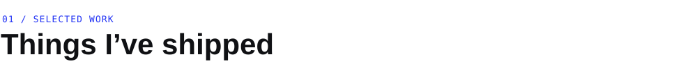

  
  <a href="https://github.com/Noufalthecoder/vanakkam"></a>

  
  <a href="https://github.com/Noufalthecoder/pivaani"></a>

  
  <a href="https://github.com/Noufalthecoder/DaNA"></a>

 

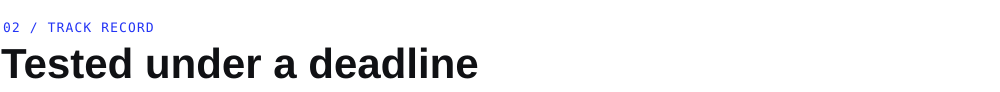


 

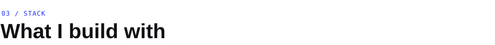


 

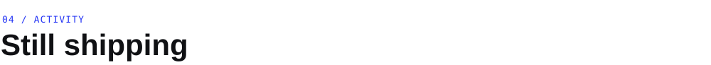


<a href="https://www.linkedin.com/in/mohammed-noufal-v-972353329/"></a>
